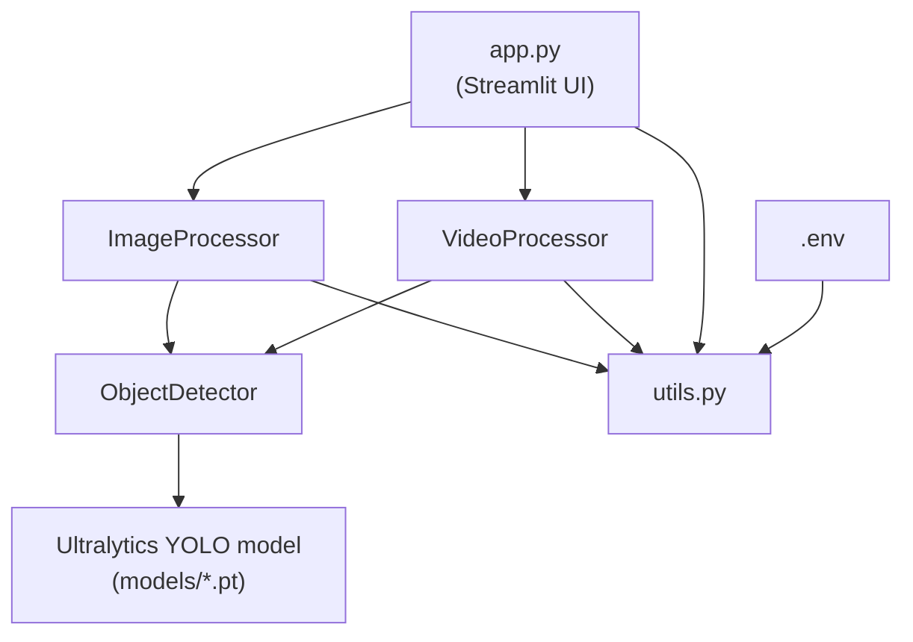

# Architecture

This document describes how the project is organised and how data flows through it.

## Design goals

- **Separation of concerns**: detection logic, image/video workflows and UI are independent layers.
- **UI-agnostic core**: everything in `src/` works from a script, a notebook or the Streamlit app.
- **Swappable model**: only `detector.py` knows about Ultralytics; the rest of the code uses plain `Detection` objects.
- **Testable**: the model is injected behind one method, so tests use a fake and need no weights.

## Layers

| Layer | File | Responsibility |
|---|---|---|
| Presentation | `app.py` | Upload widgets, threshold sliders, charts, downloads |
| Workflow | `src/image_processor.py`, `src/video_processor.py` | Read input, call the detector, draw results, write output |
| Core | `src/detector.py` | Load the model, run inference, return `Detection` objects |
| Support | `src/utils.py` | Config loading, file helpers, drawing, summaries |

Dependencies only point downward: `utils.py` never imports workflow code, and `detector.py` never imports anything from `src/` other than the standard library and NumPy. `utils.py` references `Detection` only for type hints (under `TYPE_CHECKING`) to avoid a circular import.

## Key types

### `Detection` (`detector.py`)
Frozen dataclass: `class_id`, `label`, `confidence`, `bbox=(x1, y1, x2, y2)` in pixels. Provides `to_dict()` and `area`.

### `ObjectDetector` (`detector.py`)
- Loads weights lazily (`ultralytics` is imported inside `_load_model`, keeping imports fast and tests light).
- If the weights file is missing, falls back to the file name so Ultralytics can download official weights.
- `detect(frame, confidence=None, iou=None)` accepts a BGR `numpy` array and returns `list[Detection]`. Per-call thresholds override the instance defaults.

### `ImageProcessor` (`image_processor.py`)
Returns an `ImageResult` (annotated BGR image, detections, summary, output path). Entry points: `process_array`, `process_pil`, `process_file`, `process_directory`.

### `VideoProcessor` (`video_processor.py`)
- `process_video(...)` reads frames with OpenCV, runs detection every `frame_skip` frames, reuses the last detections in between, and writes an annotated video. Returns a `VideoResult`.
- `stream(source)` is a generator for webcams and stream URLs, yielding `(annotated_frame, detections)`.
- The writer tries H.264 (`avc1`) first and falls back to `mp4v`.

## Data flow

### Image (web upload)
1. `app.py` reads the upload as a PIL image.
2. `ImageProcessor.process_pil` converts it to BGR.
3. `ObjectDetector.detect` runs YOLO inference and builds `Detection` objects.
4. `utils.draw_detections` draws boxes and labels on a copy of the image.
5. `app.py` converts back to RGB and renders the result, a summary chart and a table.

### Video
1. `app.py` saves the upload to a temporary file.
2. `VideoProcessor.process_video` loops over frames, calling the detector and drawing each frame.
3. A progress callback updates the Streamlit progress bar.
4. The annotated file is written to `data/output/` and shown in the app.

## Configuration

`utils.load_config()` reads environment variables (via `python-dotenv`) into an immutable `Config` dataclass. The Streamlit sidebar can override most values at runtime; the detector is cached with `st.cache_resource`, keyed on model path, image size and device. Confidence and IoU are passed per call, so changing the sliders does not reload the model.

## Error handling

| Situation | Behaviour |
|---|---|
| Unreadable image / video | `ValueError` with the file path |
| Empty frame passed to `detect` | `ValueError` |
| Missing weights | Warning logged, automatic download attempted |
| No usable video codec | `RuntimeError` |
| Bad file in `process_directory` | Logged and skipped; the rest continue |
| Model fails to load in the UI | Error shown, app stops cleanly |

## Extending the project

- **Different model family**: implement the same `detect()` contract and return `Detection` objects; no other file changes are needed.
- **New output format** (JSON, CSV): add a function that serialises `Detection.to_dict()`.
- **Tracking across frames**: wrap `VideoProcessor` and use Ultralytics' `model.track(...)` or a separate tracker, keeping `Detection` as the interface.
- **REST API**: build a FastAPI app on top of `ImageProcessor`, in the same way `app.py` does.

## Known limitations

- Video processing is sequential and single-threaded; large videos on CPU are slow.
- With `frame_skip > 1`, boxes on skipped frames are copied from the last detected frame and may lag fast motion.
- Uploaded videos are held in memory by Streamlit; very large files may hit upload limits.